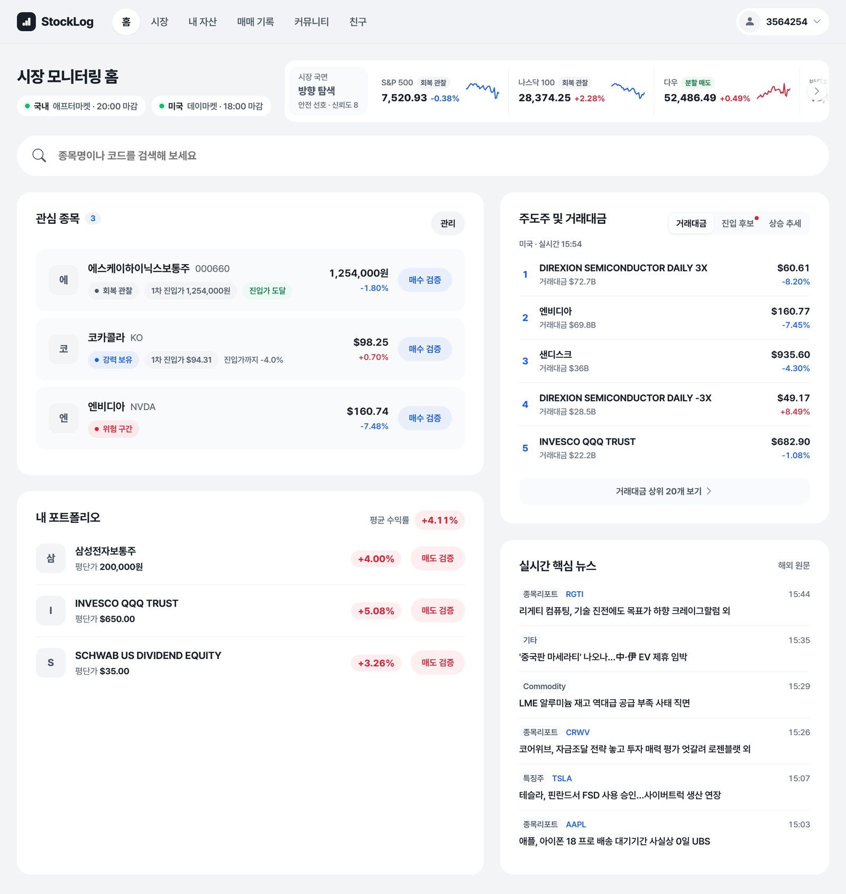
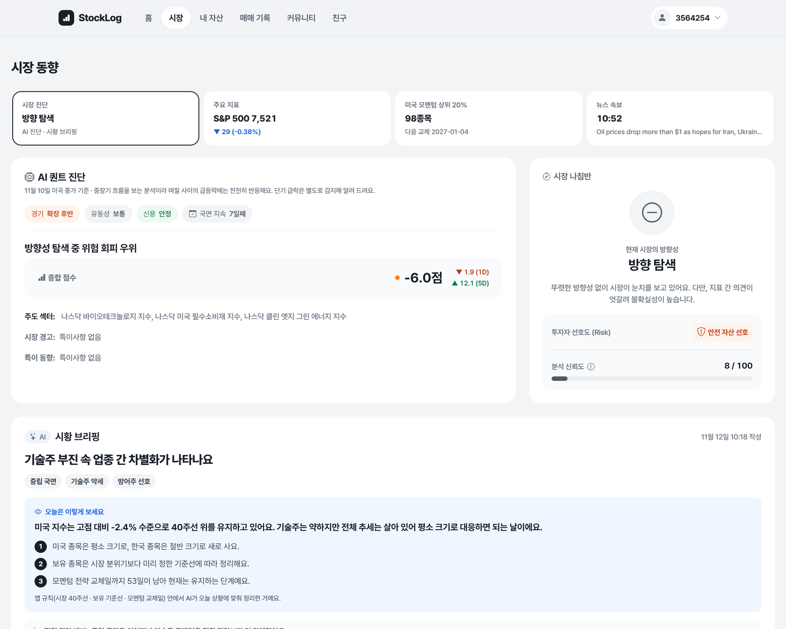
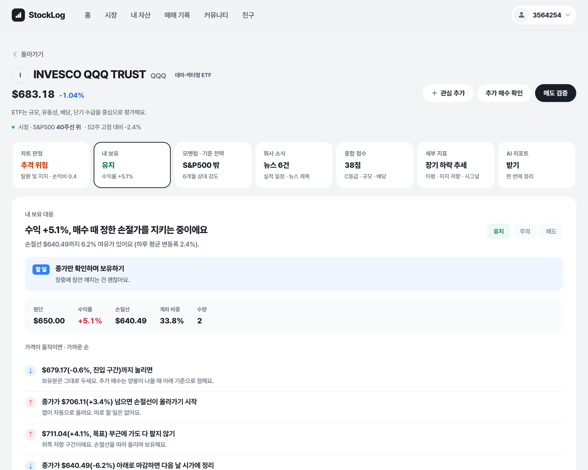
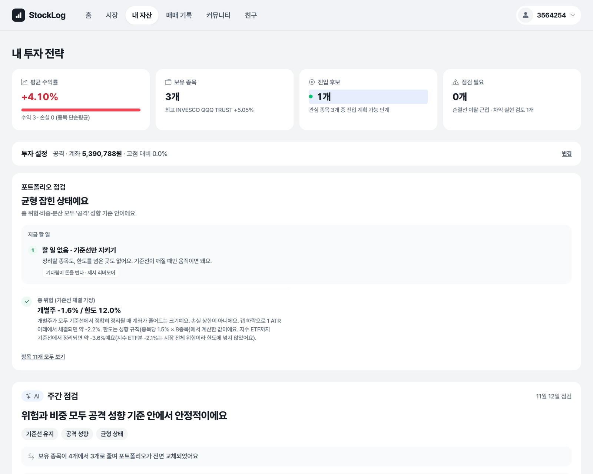
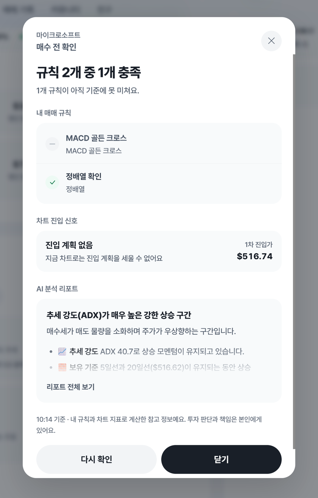
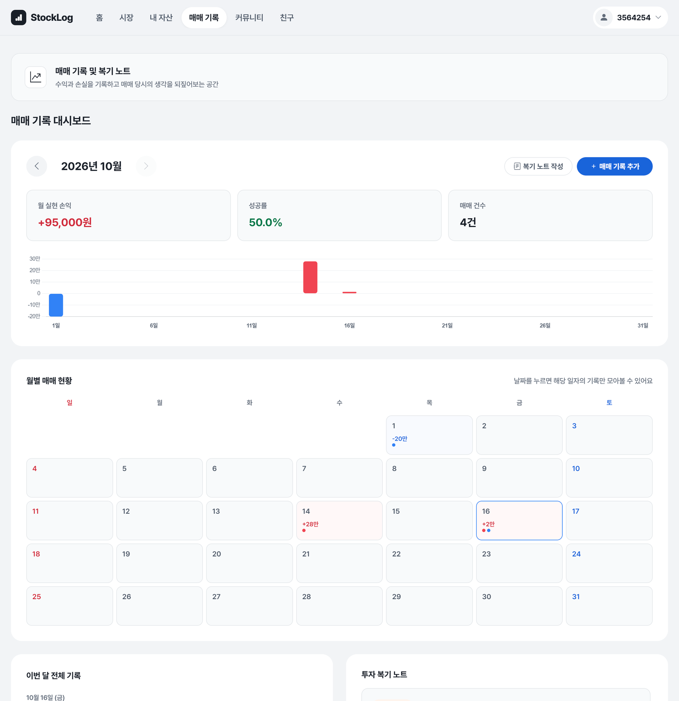
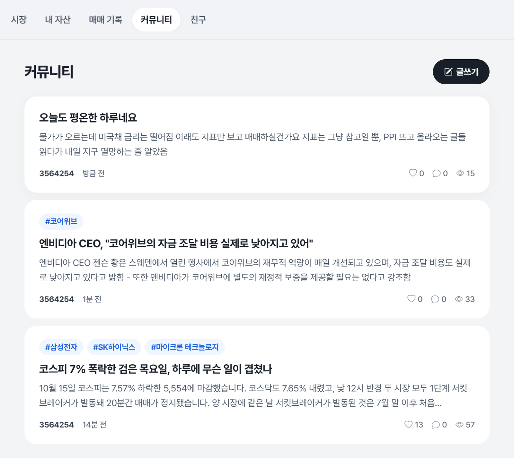
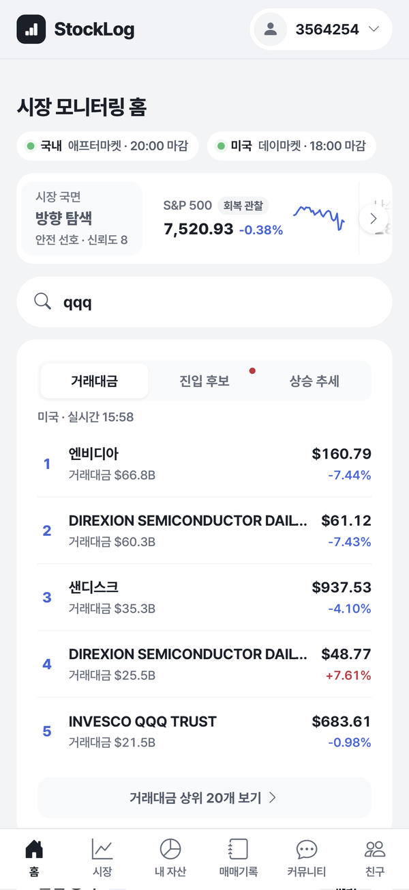
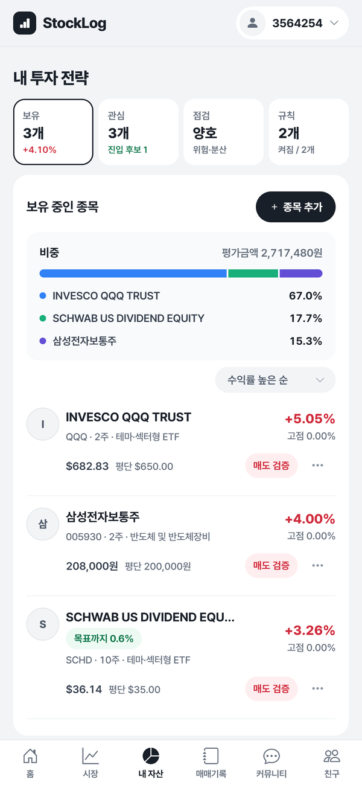
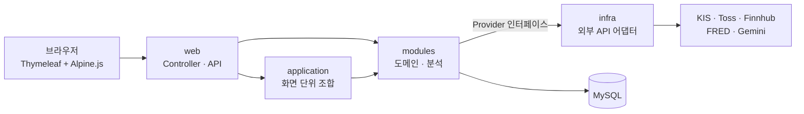

# StockLog

**매매 전에는 검증하고, 매매 후에는 복기하는 개인 투자 대시보드**




- 시장 국면과 종목을 분석하고, 내가 정한 매매 규칙으로 매수·매도를 검증합니다
- 거래를 기록하고 복기 노트를 남겨, 감이 아니라 기록으로 돌아봅니다
- 백테스트로 확인한 규칙만 판정에 쓰고, 나머지는 참고 정보로 구분해 보여 줍니다

> 개인 학습·포트폴리오용 프로젝트입니다. 분석 결과는 투자 권유가 아닙니다.

<br>

## 주요 기능

| | |
|---|---|
| **시장** | 11개 지표를 합친 시장 국면 진단, AI 시황 브리핑, 뉴스의 섹터 영향 |
| **종목 분석** | 차트 판정과 진입·손절·목표 가격, 100점 종합 점수, AI 리포트 |
| **내 자산** | 보유·관심 종목 관리, 내 매매 규칙으로 하는 매수·매도 검증 |
| **매매 기록** | 월별 손익 캘린더, 복기 노트 |
| **커뮤니티** | 종목 태그가 달린 글·댓글, 친구 포트폴리오 보기 |

<br>

## 화면

| 시장 | 종목 분석 | 내 자산 |
|---|---|---|
|  |  |  |

<details>
<summary>화면 더 보기</summary>
<br>

| 매수·매도 검증 | 매매 기록 | 커뮤니티 |
|---|---|---|
|  |  |  |

| 모바일 홈 | 모바일 내 자산 |
|---|---|
|  |  |

</details>

<br>

## 기술적 문제 해결

<!-- 작성 예정 -->

<br>

## 구조



도메인 모듈은 `NewsProvider`, `MarketOpenProvider` 같은 인터페이스에만 의존하고, 실제 호출은 `infra` 어댑터가 맡습니다. 데이터 출처를 바꿔도 도메인 코드는 그대로입니다.

시장 분석 엔진의 구성은 [docs/market-engine.md](docs/market-engine.md)에 정리했습니다.

<details>
<summary>패키지 구성</summary>

```
com.stocklog
├── web            # 페이지·JSON API 컨트롤러
├── application    # 여러 모듈을 묶는 화면 단위 조합
├── modules
│   ├── market     # 시장 분석 엔진, 지수, 뉴스, 장 운영 상태
│   ├── stock      # 시세·차트·재무, 종목 분석과 매매 신호
│   ├── purchase   # 포트폴리오, 거래 기록, 매매 규칙
│   ├── post       # 커뮤니티
│   └── member     # 회원, 친구
├── infra          # 외부 API 어댑터
└── global         # 설정, 인터셉터, 예외 처리, AOP
```

</details>

<br>

## 기술 스택

| | |
|---|---|
| **Backend** | Java 17, Spring Boot 4, Spring Data JPA, WebClient, Spring AOP |
| **Database** | MySQL (테스트: H2) |
| **Frontend** | Thymeleaf, Alpine.js, Bootstrap 5, Lightweight Charts |
| **외부 API** | 한국투자증권 KIS, Toss Invest, Finnhub, FRED, Google Gemini |

<br>

<details>
<summary>실행 방법</summary>
<br>

코드와 구조를 보여 주기 위한 저장소라, 실행하려면 외부 API 키가 필요합니다.

1. Java 17, MySQL에 `stocklog` 데이터베이스 생성
2. 환경변수 설정 (값은 저장소에 두지 않습니다)
   ```
   MYSQL_PASSWORD
   KIS_APP_KEY, KIS_APP_SECRET
   TOSS_API_KEY, TOSS_SECRET
   FINNHUB_API_KEY, FINNHUB_SECRET
   FRED_API_KEY, ALPHA_API_KEY
   EXCHANGE_AUTH_KEY, KEXIM_AUTH_KEY, TWELVE_AUTH_KEY
   GEMINI_API_KEY
   ```
3. 실행
   ```bash
   ./gradlew bootRun
   ```

Toss Open API는 요청을 보내는 PC의 IP를 콘솔에 등록해야 합니다.

</details>

<br>

## 문서

| | |
|---|---|
| [시장 분석 엔진](docs/market-engine.md) | 분석기 11개와 국면 판정 방식 |
| [디자인 원칙](docs/design.md) | 색 · 글자 · 모양 규칙 |
| [개선할 것](docs/backlog.md) | 성능 · DB · 구조 개선 목록 |
