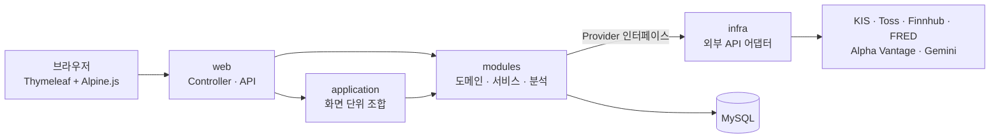

# StockLog

매매 전에는 시장과 종목을 분석하고 내 원칙으로 검증하며, 매매 후에는 기록하고 복기하는 개인 투자 대시보드

> 개인 학습 및 포트폴리오 용도의 프로젝트입니다. 제공되는 분석 정보는 투자 권유가 아니며, 투자 판단과 책임은 사용자에게 있습니다.

## 소개

증권사 앱은 주문을 넣기 위한 도구라서, 그 앞뒤의 "판단"과 "기록"은 여러 사이트와 메모장에 흩어져 있었습니다.
StockLog는 그 앞뒤를 한곳에 모으려고 만들었습니다. 주문은 넣지 않습니다.

- **매매 전**: 시장 국면과 종목 점수를 확인하고, 내가 정한 매매 규칙에 계획한 매수·매도를 대 봅니다.
- **매매 후**: 거래를 기록하고 복기 노트를 남겨, 감이 아니라 기록으로 돌아봅니다.
- **함께**: 소수의 친구끼리 서로의 포트폴리오를 보고, 종목별로 이야기를 나눕니다.

## 화면

### 시장 국면 진단


### 종목 분석


### 포트폴리오


## 주요 기능

| 영역 | 내용 |
|---|---|
| **홈** | 관심·보유 종목 상태, 국내·미국 장 운영 상태, 거래대금 상위 종목(국내 정규장 중에는 국내, 그 외에는 미국), 국내 핵심 뉴스 |
| **시장 분석** | 11개 분석기(추세, 모멘텀, 시장 폭, 위험, 금리, 유동성, 거시, 신용, 섹터, 방어, 교차 자산)와 괴리·급변 감지기의 점수를 가중치 엔진으로 합쳐 시장 국면을 판정, 지수 차트, 환율, 해외 뉴스, AI 시장 코멘트 |
| **종목 분석** | 모멘텀·기술적 지표·밸류에이션 점수를 합친 100점 점수와 등급(S~D), 진입 구간·손절·목표가를 계산하는 매매 신호 엔진, AI 코멘트 |
| **포트폴리오** | 보유 종목과 비중, 관심 종목, 내가 만든 매매 규칙으로 하는 매수 검증과 손절·목표가 기준의 매도 검증 |
| **매매 기록** | 월별 거래 내역, 감정·점수를 함께 남기는 복기 노트 |
| **커뮤니티** | 글·댓글·대댓글·좋아요, 글에 종목을 해시태그처럼 붙여 종목별로 모아 보기 |
| **친구** | 친구 요청·수락, 친구의 포트폴리오 보기 |

## 기술 스택

| 구분 | 사용 기술 |
|---|---|
| Backend | Java 17, Spring Boot 4, Spring MVC, Spring Data JPA, WebClient, Spring AOP, Bean Validation |
| Database | MySQL (테스트는 H2) |
| Frontend | Thymeleaf(서버 렌더링), Alpine.js, Bootstrap 5, Lightweight Charts, Chart.js |
| 외부 API | 한국투자증권 KIS Open API, Toss Invest Open API, Finnhub, FRED, Alpha Vantage, 환율 API, Google Gemini |
| 기타 | Gradle, Lombok, Spring Security Crypto(BCrypt), P6Spy |

## 구조



```
com.stocklog
├── web            # 페이지 Controller, JSON API Controller, 화면 공통 Advice
├── application    # 여러 모듈을 묶는 화면 단위 조합 (홈 대시보드 등)
├── modules        # 업무 기능
│   ├── market     #   시장 분석 엔진, 지수, 환율, 뉴스, 장 운영 상태, 거래대금 순위
│   ├── stock      #   종목 정보·시세·차트·재무·밸류에이션, 종목 분석과 매매 신호
│   ├── purchase   #   포트폴리오, 거래 기록, 매매 규칙, 관심 종목
│   ├── post       #   커뮤니티 (글, 댓글, 좋아요, 종목 태그)
│   └── member     #   회원, 친구
├── infra          # 외부 API 어댑터 (kis, toss, finnhub, fred, alpha, gemini, exchange)
└── global         # 설정, 로그인 인터셉터, 예외 처리, AOP(로깅·재시도)
```

모듈은 `NewsProvider`, `MarketOpenProvider`, `MarketRankingProvider` 같은 인터페이스에만 의존하고, 실제 호출은 `infra`의 어댑터가 맡습니다. 데이터 출처를 바꾸거나 추가해도 모듈 코드는 그대로 둘 수 있게 하려는 구조입니다.

## 실행 방법

다른 사람이 설치해 쓰는 용도보다는 코드와 구조를 보여 주기 위한 저장소입니다. 직접 실행하려면 아래가 필요합니다.

- Java 17, MySQL(`stocklog` 데이터베이스)
- 각 외부 API의 키 (Toss Open API는 콘솔에 요청을 보내는 PC의 IP 등록 필요)
- `libs/yfinance4j-0.1.7.jar` (저장소에 포함되어 있지 않음)

환경변수 (값은 저장소에 두지 않습니다)

```
MYSQL_PASSWORD
KIS_APP_KEY, KIS_APP_SECRET
TOSS_API_KEY, TOSS_SECRET
FINNHUB_API_KEY, FINNHUB_SECRET
FRED_API_KEY, ALPHA_API_KEY
EXCHANGE_AUTH_KEY, KEXIM_AUTH_KEY, TWELVE_AUTH_KEY
GEMINI_API_KEY
```

```bash
./gradlew bootRun        # Windows: .\gradlew.bat bootRun
```

## 앞으로 할 것

- **보안**: Spring Security 도입(CSRF 보호, 세션 관리), 로그인 시도 횟수 제한, 권한 검사 일원화
- **성능**: 시장 화면의 AI 코멘트를 렌더링 경로에서 분리(비동기 생성), 대량 더미 데이터로 페이징·인덱스 효과 측정
- **동시성**: 좋아요·보유 종목 수정 동시 요청 테스트, 외부 API 토큰 재사용
- **품질**: 분석 엔진과 서비스 단위 테스트 확대, 스키마 변경 이력 관리(Flyway), 시장 국면 신뢰도 계산 개선
