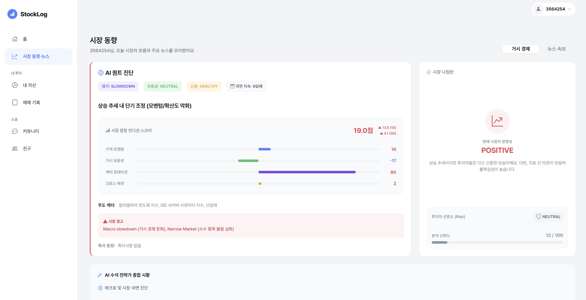
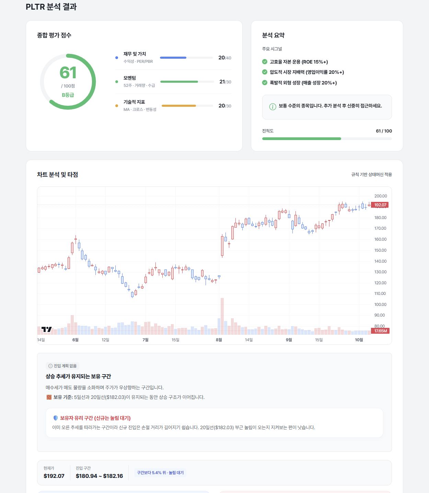
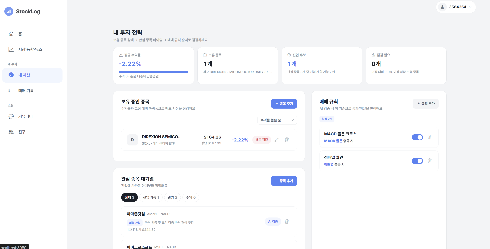

# StockLog

12개 지표 분석기와 가중치 엔진으로 시장 국면을 진단하고, 종목 진입 구간을 제시하는 투자 분석 웹 서비스

> 개인 학습 및 포트폴리오 용도의 프로젝트입니다. 제공되는 분석 정보는 투자 권유가 아니며, 투자 판단과 책임은 사용자에게 있습니다.

## 소개

감으로 하던 매매를 기록과 원칙, 데이터 기반 분석으로 바꾸기 위해 만든 개인 투자 대시보드입니다.
국내·해외 시세와 재무 데이터로 종목을 분석하고, 매매 기록과 투자 원칙을 함께 관리합니다.

- **시장 국면 진단**: 추세, 모멘텀, 위험, 금리 등 12개 분석기 결과를 가중치 엔진으로 종합해 시장 국면을 판정하고 AI 코멘트를 제공합니다.
- **종목 분석**: 모멘텀, 기술적 지표, 밸류에이션 점수와 등급, 매매 진입 구간을 제시합니다.
- **포트폴리오·매매 기록**: 보유 종목, 관심 종목, 거래 내역과 투자 원칙 점검을 관리합니다.

**Tech**: Java 17 · Spring Boot · Spring Data JPA · Thymeleaf · MySQL · Gemini API

## 화면

### 시장 국면 진단

### 종목 분석

### 포트폴리오
